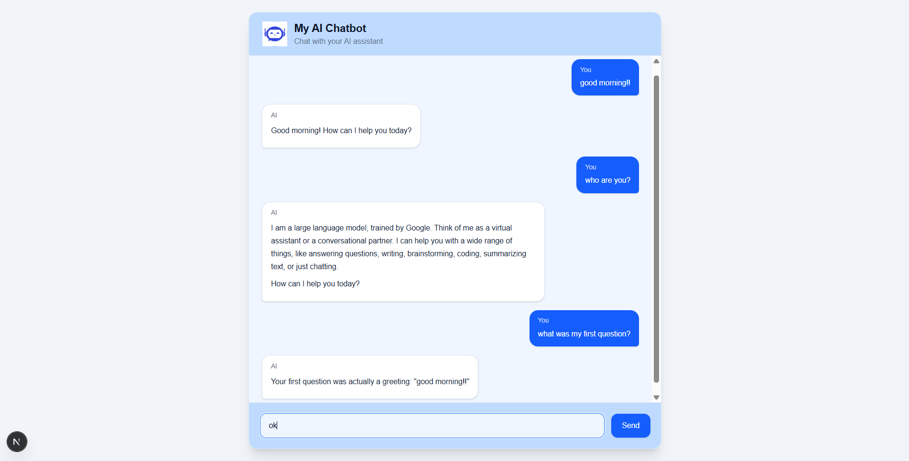

# My AI Chatbot

A simple, responsive AI chatbot built with Next.js, React, Tailwind CSS 4, and the Google Gemini API. It supports conversation history during the current session and displays AI replies with Markdown formatting.

## Screenshot



## Requirements

- Node.js and npm
- A Google Gemini API key

## Getting started

1. Install the project dependencies:

   ```bash
   npm install
   ```

2. Create a `.env.local` file in the project root and add your Gemini API key:

   ```env
   GEMINI_API_KEY=your_gemini_api_key
   ```

   Keep this key private. Do not prefix it with `NEXT_PUBLIC_` or commit `.env.local`.

3. Start the development server:

   ```bash
   npm run dev
   ```

4. Open [http://localhost:3000](http://localhost:3000).

## Features

- Responsive chat interface with separate user and AI message bubbles
- Gemini-powered general-purpose responses
- Conversation context sent with each message
- Markdown formatting for AI responses
- Loading and error feedback
- API key used only in the server-side chat route

## Project structure

- `app/page.js` — chat interface and message handling
- `app/chat/route.js` — server-side Gemini API endpoint (`POST /chat`)
- `app/layout.js` — root layout and global stylesheet import
- `app/globals.css` — Tailwind CSS entry point

## Useful commands

- `npm run dev` — start the development server
- `npm run lint` — check the code with ESLint
- `npm run build` — create a production build
- `npm run start` — serve the production build
